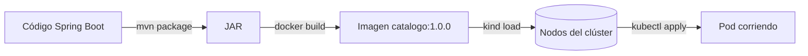

## Objetivos

- Explicar qué es una imagen, un contenedor y un registro, y por qué Kubernetes no corre código sino imágenes.
- Empaquetar una aplicación Spring Boot en una imagen pequeña y reproducible.
- Levantar un clúster local con kind y cargarle la imagen sin pasar por un registro.

## Del código al clúster



## Dockerfile en dos etapas

La primera etapa compila con el JDK completo. La segunda copia solo lo necesario sobre un JRE y corre sin root. Las capas de dependencias van primero para que un cambio en el código no invalide la caché completa.



{: .tip }
Si no quieres mantener un Dockerfile, el plugin de Spring Boot construye la imagen con Buildpacks: `./mvnw spring-boot:build-image -Dspring-boot.build-image.imageName=catalogo:1.0.0`. El resultado ya viene en capas y con un JRE ajustado a la memoria del contenedor.

```bash
docker build -t catalogo:1.0.0 .
docker run --rm -p 8080:8080 catalogo:1.0.0
curl -s localhost:8080/actuator/health
```

## Clúster local con kind

kind corre cada nodo de Kubernetes como un contenedor Docker. Este archivo crea un control-plane y dos workers, y expone los puertos 80 y 443 para que el Ingress de la clase 3 funcione desde el navegador.



```bash
kind create cluster --name softav --config kind-config.yaml
kubectl cluster-info --context kind-softav
kubectl get nodes -o wide

# La imagen local se copia a los nodos; no hace falta un registro.
kind load docker-image catalogo:1.0.0 --name softav
```

{: .warning }
En Windows usa WSL2 con Docker Desktop o Rancher Desktop. Si `kind create cluster` falla por memoria, baja a un solo worker: el curso no necesita más.

## Comandos que usarás toda la vida

```bash
kubectl get pods -A                    # todo lo que corre en el clúster
kubectl describe pod <nombre> -n <ns>  # eventos: aquí está el 80% de los errores
kubectl logs -f <nombre> -n <ns>       # salida del contenedor
kubectl explain pod.spec.containers    # documentación sin salir de la terminal
```

{: .exam }
El examen CKAD se hace en una terminal sin autocompletado configurado. Lo primero que debes teclear es `alias k=kubectl` y `export do="--dry-run=client -o yaml"`. Practica desde hoy con esos alias.

## Para la siguiente clase

- Instala kind, kubectl y Docker. Verifica con `kubectl version --client` y `kind version`.
- Crea una app Spring Boot con `web` y `actuator` en [start.spring.io](https://start.spring.io) y construye su imagen con el Dockerfile de arriba.
