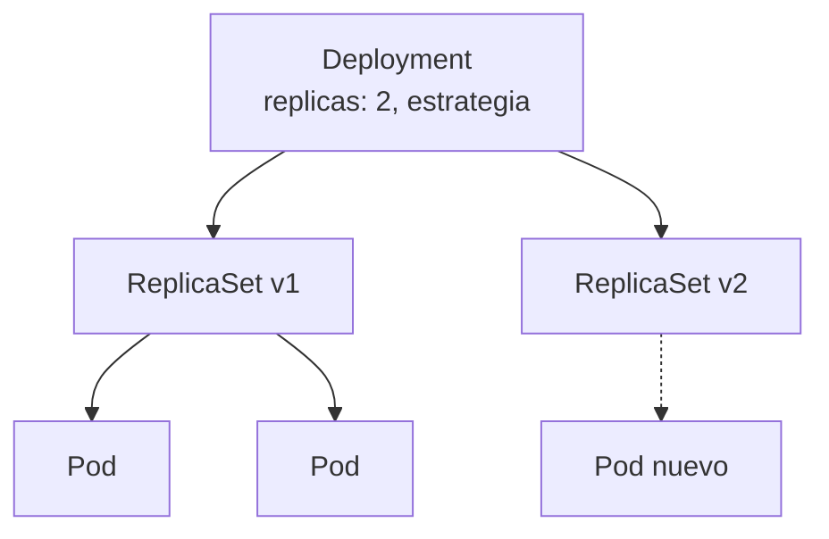

## Objetivos

- Distinguir Pod, ReplicaSet y Deployment, y saber cuál se escribe a mano y cuáles no.
- Generar manifiestos con `kubectl` en modo imperativo y pasarlos a declarativo.
- Hacer un rollout, observarlo y revertirlo.

## Quién controla a quién



Nunca creas Pods sueltos en producción: si el nodo muere, nadie los recrea. El Deployment guarda el historial de ReplicaSets y por eso puede hacer rollback.

## Namespace con cuota

Antes de desplegar, un espacio propio. La cuota y el LimitRange evitan que un Pod sin límites se coma el clúster compartido.



## El Deployment completo

El Deployment lee variables de entorno de un ConfigMap y un Secret, que veremos a fondo en la clase 3. Por ahora aplícalos tal cual.





## De imperativo a declarativo

No memorices YAML. Pídeselo a `kubectl` y edítalo.

```bash
kubectl create deployment catalogo --image=catalogo:1.0.0 --replicas=2 \
  --namespace softav --dry-run=client -o yaml > deployment.yaml

kubectl apply -f deployment.yaml
kubectl get deploy,rs,pods -n softav -o wide
kubectl describe deploy catalogo -n softav
```

## Rollouts

```bash
kubectl set image deploy/catalogo app=catalogo:1.1.0 -n softav
kubectl rollout status deploy/catalogo -n softav
kubectl rollout history deploy/catalogo -n softav
kubectl rollout undo deploy/catalogo -n softav
```

Con `maxUnavailable: 0` el Deployment nunca baja de dos réplicas listas durante la actualización. Con `maxSurge: 1` sube un Pod extra mientras tanto. Observa el ReplicaSet viejo bajar a cero y quedarse ahí: es el que usa `rollout undo`.

{: .note }
Si el tag `1.1.0` no existe, el rollout se queda en `ImagePullBackOff` y el ReplicaSet viejo sigue sirviendo tráfico. Eso es el comportamiento correcto: el despliegue roto nunca reemplaza al bueno.

{: .exam }
Te van a pedir "escalar a 5 réplicas", "cambiar la imagen" o "volver a la versión anterior" en menos de un minuto. Las respuestas son `kubectl scale`, `kubectl set image` y `kubectl rollout undo`. Ninguna necesita abrir un editor.

## Ejercicio

1. Escala a 4 réplicas y mira cómo se reparten entre los dos workers con `kubectl get pods -o wide`.
2. Borra un Pod a mano. Cuenta cuánto tarda el ReplicaSet en reponerlo.
3. Cambia la imagen a un tag inexistente, observa el estado y revierte.
