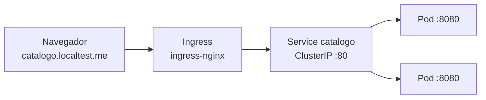

## Objetivos

- Exponer los Pods con un Service estable y entender cómo los encuentra por labels.
- Publicar la aplicación hacia afuera con un Ingress y un controlador.
- Externalizar la configuración de Spring Boot con ConfigMaps y Secrets.

## El camino de una petición



Los Pods cambian de IP cada vez que nacen. El Service tiene una IP y un nombre DNS fijos, y mantiene la lista de Pods que coinciden con su selector. El Ingress solo sabe de Services, nunca de Pods.

## Service



```bash
kubectl apply -f service.yaml
kubectl get svc,endpointslices -n softav
# Dentro del clúster el nombre resuelve: catalogo.softav.svc.cluster.local
kubectl run -n softav tmp --rm -it --image=busybox:1.36 -- wget -qO- http://catalogo/actuator/health
```

{: .warning }
Si `endpointslices` sale vacío, el selector del Service no coincide con las labels de los Pods. Es el error más común del curso y del examen. Compara con `kubectl get pods -n softav --show-labels`.

## Ingress

Primero el controlador. kind tiene un manifiesto oficial de ingress-nginx que escucha en los puertos que mapeamos en la clase 1.

```bash
kubectl apply -f https://kubernetes.github.io/ingress-nginx/deploy/static/provider/kind/deploy.yaml
kubectl wait --namespace ingress-nginx --for=condition=ready pod \
  --selector=app.kubernetes.io/component=controller --timeout=120s
```



```bash
kubectl apply -f ingress.yaml
curl -i http://catalogo.localtest.me/actuator/health
```

## Configuración externalizada

Spring Boot lee cualquier propiedad desde una variable de entorno. `app.saludo` se puede sobreescribir con `APP_SALUDO`, y `spring.profiles.active` con `SPRING_PROFILES_ACTIVE`. Así la misma imagen sirve para desarrollo, pruebas y producción.





```bash
# Cambia el saludo sin reconstruir la imagen
kubectl edit configmap catalogo-config -n softav
kubectl rollout restart deploy/catalogo -n softav

# Secrets desde la terminal, nunca desde Git
kubectl create secret generic catalogo-db -n softav \
  --from-literal=DB_USER=catalogo --from-literal=DB_PASSWORD='s3cr3t' \
  --dry-run=client -o yaml
```

{: .note }
Las variables de entorno se leen al arrancar el proceso. Cambiar el ConfigMap no cambia nada hasta que los Pods se reinician. Si montas el ConfigMap como volumen, Kubernetes sí actualiza el archivo en caliente.

{: .exam }
Dominas este tema cuando puedes crear un ConfigMap con `--from-literal`, montarlo como `envFrom` y como volumen, y explicar la diferencia entre `port`, `targetPort` y `nodePort` sin mirar la documentación.

## Ejercicio

1. Cambia el selector del Service a un label equivocado y diagnostica el síntoma desde el navegador hasta el `endpointslice`.
2. Agrega una segunda ruta en el Ingress que lleve `/api` a otro Service.
3. Monta el ConfigMap como volumen en `/config` y comprueba con `kubectl exec` que el archivo cambia sin reiniciar.
