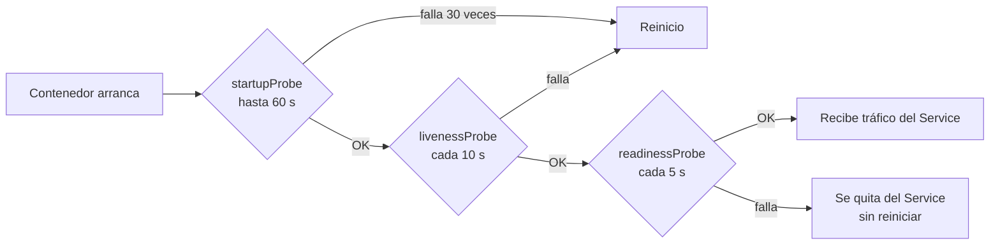

## Objetivos

- Configurar startup, liveness y readiness probes con Spring Boot Actuator.
- Dimensionar requests y limits para una JVM sin provocar OOMKilled.
- Escalar automáticamente con un HorizontalPodAutoscaler.
- Diagnosticar un despliegue roto en el primer escenario break-fix del curso.

## Las tres probes



Actuator publica dos endpoints distintos a propósito. Liveness dice "el proceso está vivo"; si falla, el kubelet reinicia el contenedor. Readiness dice "puedo atender peticiones"; si falla, el Service deja de enviarle tráfico pero no lo mata. Una base de datos caída debe tumbar la readiness, nunca la liveness, o reiniciarás Pods sanos en cadena.



La sección de probes del Deployment de la clase 2:

```yaml
startupProbe:
  httpGet: { path: /actuator/health/liveness, port: http }
  failureThreshold: 30
  periodSeconds: 2
livenessProbe:
  httpGet: { path: /actuator/health/liveness, port: http }
  periodSeconds: 10
readinessProbe:
  httpGet: { path: /actuator/health/readiness, port: http }
  periodSeconds: 5
```

{: .tip }
Con `server.shutdown: graceful` y `terminationGracePeriodSeconds: 30`, al borrar un Pod Spring deja de aceptar conexiones nuevas, termina las que estaban en curso y luego sale. Sin eso, cada rollout corta peticiones a la mitad.

## Recursos y la JVM

`requests` es lo que el scheduler reserva para colocar el Pod. `limits` es el techo: pasar el límite de memoria significa OOMKilled inmediato. La JVM no sabe nada de Kubernetes salvo que se lo digas, por eso el ConfigMap lleva `JAVA_TOOL_OPTIONS=-XX:MaxRAMPercentage=75.0`: el heap usa el 75% del límite y deja el resto para metaspace, hilos y buffers.

```bash
kubectl top pods -n softav
kubectl describe pod -n softav -l app=catalogo | grep -A3 "Last State"
```

## Autoescalado



```bash
# metrics-server no viene con kind; en local necesita saltarse la verificación TLS del kubelet
kubectl apply -f https://github.com/kubernetes-sigs/metrics-server/releases/latest/download/components.yaml
kubectl patch -n kube-system deployment metrics-server --type=json \
  -p '[{"op":"add","path":"/spec/template/spec/containers/0/args/-","value":"--kubelet-insecure-tls"}]'

kubectl apply -f hpa.yaml
kubectl run -n softav carga --rm -it --image=busybox:1.36 -- \
  sh -c "while true; do wget -q -O- http://catalogo/actuator/health > /dev/null; done"
kubectl get hpa -n softav --watch
```

{: .exam }
El HPA se calcula contra `requests.cpu`, no contra `limits`. Si el contenedor no tiene request de CPU, el HPA muestra `<unknown>` y no escala nunca. Es una pregunta clásica.

## Break-fix 01

Este manifiesto está roto en varios lugares. Aplícalo y arréglalo sin mirar la solución. En la calificación presencial trabajarás exactamente así: un clúster, un problema y la pizarra.



```bash
kubectl apply -f {{ site.snippets_raw_url }}/break-fix-01.yaml
kubectl get pods -n softav -l app=catalogo-bf --watch
```

Síntomas que debes saber leer:

| Estado del Pod | Qué mirar | Causa típica |
|---|---|---|
| `ImagePullBackOff` | `describe pod`, sección Events | Tag o nombre de imagen mal escrito |
| `CreateContainerConfigError` | `describe pod`, Events | ConfigMap o Secret referenciado no existe |
| `OOMKilled` en `Last State` | `describe pod`, `kubectl top` | Límite de memoria menor que lo que la JVM necesita |
| `Running` pero `0/1 READY` | `describe pod`, Readiness probe failed | Ruta o puerto de la probe equivocados |
| Pods listos pero `curl` falla | `get endpointslices` | Selector del Service no coincide con las labels |

<details markdown="1">
<summary>Solución</summary>

1. `image: catalogo:1.0.O` termina en la letra O, no en cero. Corrige a `1.0.0`.
2. `configMapRef.name: catalogo-bf-cfg` no existe. El ConfigMap se llama `catalogo-bf-config`.
3. `limits.memory: 64Mi` no alcanza para arrancar la JVM. Sube a `512Mi` y pon un request de `384Mi`.
4. La readiness apunta a `/health`. Actuator responde en `/actuator/health/readiness`.
5. El selector del Service dice `catalago-bf`. Debe ser `catalogo-bf`.

Verificación final: `kubectl run -n softav tmp --rm -it --image=busybox:1.36 -- wget -qO- http://catalogo-bf/actuator/health` responde `{"status":"UP"}`.

</details>
