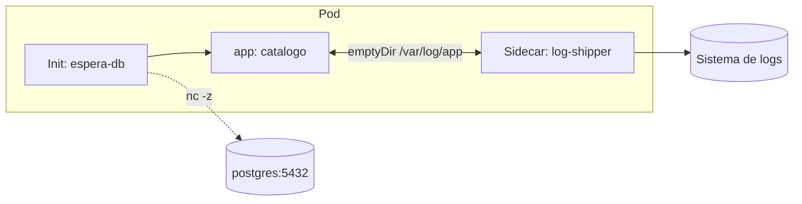

## Objetivos

- Reconocer los patrones estructurales de Kubernetes y relacionarlos con los patrones de diseño clásicos.
- Componer un Pod con Init Container y Sidecar sin tocar el código de la aplicación.
- Entender qué problema resuelve un Operator y cuándo no hace falta uno.

## Los patrones y sus primos de GoF

Un Pod puede tener varios contenedores que comparten red y volúmenes. Esa es la base de todos los patrones estructurales. Si ya conoces los patrones de diseño de software, cada uno te va a sonar.

| Patrón K8s | Qué resuelve | Se parece a | Ejemplo |
|---|---|---|---|
| Init Container | Preparar algo antes de que arranque la app | Template Method, fase de setup | Esperar la base de datos, correr migraciones |
| Sidecar | Agregar capacidad sin modificar la app | Decorator | Enviar logs, recargar configuración, proxy de malla |
| Ambassador | Simplificar el acceso a servicios externos | Proxy | Un contenedor local que hace el TLS y el retry hacia la base de datos |
| Adapter | Uniformar lo que la app expone hacia afuera | Adapter | Convertir los logs o métricas al formato que espera Prometheus |
| Operator | Codificar el conocimiento operativo de una aplicación | Controller + Strategy | Operadores de PostgreSQL, Kafka o Prometheus |



## Init Container + Sidecar en un Pod



El Init Container corre hasta terminar y solo entonces arrancan los demás. El sidecar lee el mismo archivo que escribe la app porque ambos montan el mismo `emptyDir`. La app no sabe que existe el sidecar: ese es el punto.

```bash
# Un postgres de mentira para que el init container pueda terminar
kubectl run postgres -n softav --image=postgres:16 --port=5432 --expose \
  --env=POSTGRES_PASSWORD=demo

kubectl apply -f patrones-sidecar.yaml
kubectl get pod catalogo-patrones -n softav --watch      # Init:0/1 -> PodInitializing -> Running 2/2
kubectl logs catalogo-patrones -n softav -c espera-db
kubectl logs catalogo-patrones -n softav -c log-shipper -f
```

{: .note }
Desde Kubernetes 1.29 un sidecar se puede declarar como `initContainer` con `restartPolicy: Always`. Arranca antes que la app, vive mientras ella viva y se apaga después. Es la forma recomendada para sidecars de logs y proxies.

{: .exam }
Cuando te pidan "agregar un contenedor que lea los logs de la app" la respuesta siempre es un volumen `emptyDir` compartido más un segundo contenedor. Y para ver sus logs necesitas `-c <nombre>`, porque el Pod tiene más de uno.

## Operators en dos frases

Un Operator es un controlador que observa un recurso personalizado, por ejemplo `kind: PostgresCluster`, y hace lo que haría un administrador humano: crear réplicas, hacer backups, promover un primario. Úsalo cuando la operación de la aplicación tenga reglas que un Deployment no expresa. Para una API stateless de Spring Boot no necesitas uno.

## Lectura

El libro [Kubernetes Patterns](https://developers.redhat.com/e-books/kubernetes-patterns) de Ibryam y Huß, gratis en PDF desde Red Hat, cubre todos estos patrones con ejemplos. Los capítulos 15 a 18 son los de esta clase.

## Ejercicio

1. Convierte el sidecar al estilo nativo de 1.29 con `restartPolicy: Always` y compara el orden de arranque y apagado.
2. Agrega un contenedor Ambassador con `nginx` que escuche en `localhost:5432` y reenvíe a `postgres:5432`. La app debe seguir conectándose a localhost.
3. Identifica en tu proyecto del curso un comportamiento transversal que hoy vive en el código y que podría ser un sidecar.
